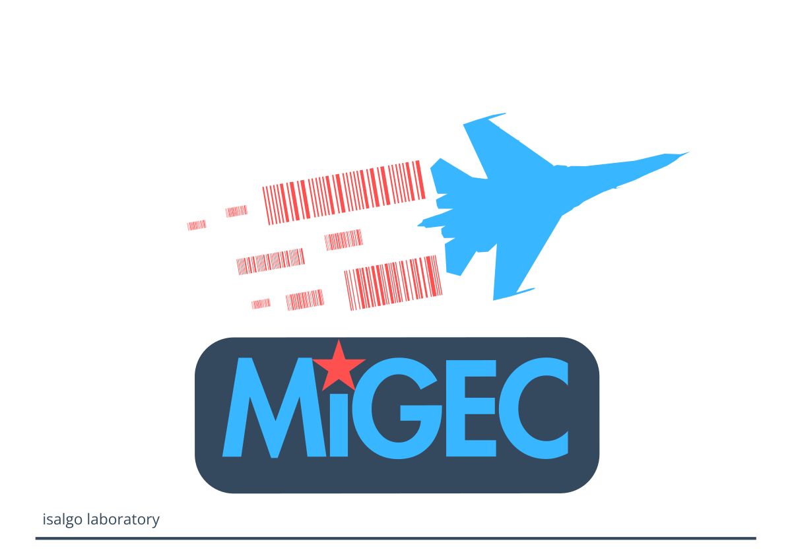
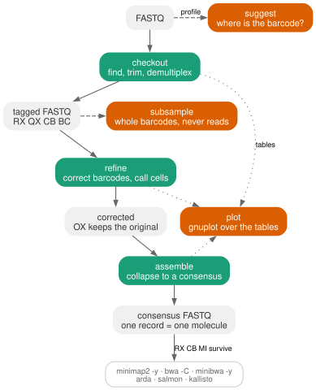
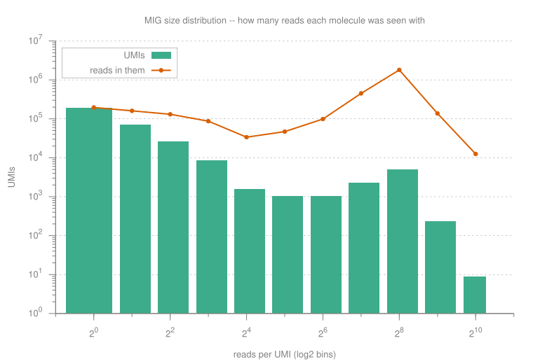

<p align="center">
  <picture>
    <source media="(prefers-color-scheme: dark)" srcset="https://raw.githubusercontent.com/antigenomics/migec/master/assets/migec_dark.png">
    
  </picture>
</p>

<p align="center">
  <a href="https://pypi.org/project/migec/"></a>
  <a href="https://github.com/antigenomics/migec/actions/workflows/ci.yml"></a>
  <a href="https://antigenomics.github.io/migec/"></a>
  
  
  
</p>

<h1 align="center">migec — molecular identifiers, reliable consensus</h1>

**Extract barcodes, correct UMI errors and assemble molecular consensus sequences.**
MIGEC combines a C++20 core with a Python CLI for bulk and cell-barcoded sequencing.
It reconstructs molecules; receptor annotation belongs to [ARDA](https://github.com/antigenomics/arda).

<p align="center"></p>

## Install

```bash
pip install migec
migec info
```

Binary wheels support CPython 3.10–3.13 on Linux x86-64 and macOS arm64.
For a source checkout, run `bash setup.sh`. See [installation](https://antigenomics.github.io/migec/installation.html).
The original Groovy version remains on [`legacy-v1`](https://github.com/antigenomics/migec/tree/legacy-v1).

## Quick start

Declare the barcode layout from your library protocol, then run the three stages:

```bash
migec checkout reads.fq.gz --bc-pattern '^NNNNNNNN' --sample S1 -o out/
migec refine out/S1.fq.gz -o ref/
migec assemble ref/S1.fq.gz -o cons/
```

`N` captures a UMI base; `X` captures a cell-barcode base. Positional slices such as
`0:8`, named chemistry presets and sample barcode tables are also supported.
Use [layouts](https://antigenomics.github.io/migec/layouts.html) to match your protocol,
and [examples](https://antigenomics.github.io/migec/examples.html) for paired and single-cell libraries.

| Stage | Result |
|---|---|
| `checkout` | Trimmed, tagged reads and extraction QC |
| `refine` | Corrected UMI assignments, parent lineage and error diagnostics |
| `assemble` | Consensus FASTQ, molecule tables and confidence estimates |
| `plot` | QC figures derived from the stage TSVs |

Molecule identity includes sample, cell and UMI. Consensus FASTQ preserves identifiers in
read names and SAM-style tags. `--min-reads` defaults to 1: shallow molecules remain represented.
Use `migec subsample` for a smaller library while retaining all reads of selected molecules.

## Why MIGEC

- **Evidence-aware correction.** Required seqtree searches support quality-aware UMI correction;
  bulk correction supports two substitutions, while cell-tagged correction retains radius one.
  Homopolymer UMI indel correction is not implemented.
- **Honest consensus confidence.** Quality is capped by the pre-amplification error floor;
  consensus cannot remove errors already present before amplification.
- **Inspectable results.** Barcode lineage, depth, collisions and quality are reported beside
  the consensus. Read counts and molecule counts remain distinct.
- **Native processing.** Streaming C++ stages expose a Python API and thread budgets for
  workstation and scheduled-cluster use.

<p align="center"></p>

The illustration above is measured QC, not a schematic. Existing benchmark results, their
populations and tradeoffs remain in [post-processing](https://antigenomics.github.io/migec/postprocessing.html),
[validation](https://antigenomics.github.io/migec/validation.html) and
[performance](https://antigenomics.github.io/migec/performance.html).

## Documentation

Documentation follows the four Diátaxis needs:

| Need | Start here |
|---|---|
| **Tutorial — learn by running** | [Quickstart](https://antigenomics.github.io/migec/quickstart.html), [worked examples](https://antigenomics.github.io/migec/examples.html) |
| **How-to — complete a task** | [Layouts](https://antigenomics.github.io/migec/layouts.html), [existing UMI tags](https://antigenomics.github.io/migec/byo_umi.html), [cohorts](https://antigenomics.github.io/migec/nextflow.html), [downstream tools](https://antigenomics.github.io/migec/downstream.html) |
| **Reference — look up an interface** | [Commands](https://antigenomics.github.io/migec/commands.html), [formats](https://antigenomics.github.io/migec/formats.html) |
| **Explanation — understand decisions** | [Method](https://antigenomics.github.io/migec/method.html), [quality floor](https://antigenomics.github.io/migec/quality_floor.html), [barcode space](https://antigenomics.github.io/migec/barcode_space.html) |

## Development and agent use

```bash
bash setup.sh
source .venv/bin/activate
python -m pytest tests/unit tests/synthetic -q
ruff check python/ tests/
sphinx-build -W --keep-going -b html docs docs/_build/html
```

The repository skill is [`skills/migec/SKILL.md`](https://github.com/antigenomics/migec/blob/master/skills/migec/SKILL.md).
Design and measured limitations live in [`project/`](https://github.com/antigenomics/migec/tree/master/project/) and [`ROADMAP.md`](https://github.com/antigenomics/migec/blob/master/ROADMAP.md);
public data provenance is in [`SOURCES.md`](https://github.com/antigenomics/migec/blob/master/SOURCES.md).

## Citing

Until the v2 paper exists, cite the original methods:

- Shugay M *et al.* Towards error-free profiling of immune repertoires. *Nat Methods* 11:653–655
  (2014). doi:10.1038/nmeth.2960
- Shugay M *et al.* MAGERI: Computational pipeline for molecular-barcoded targeted resequencing.
  *PLoS Comput Biol* 13(5):e1005480 (2017). doi:10.1371/journal.pcbi.1005480
- Turchaninova MA *et al.* High-quality full-length immunoglobulin profiling with unique molecular 
  barcoding. *Nat Protoc* 11(9):1599-616 (2016). doi: 10.1038/nprot.2016.093

## License

GPL-3.0-or-later. See [`LICENSE`](https://github.com/antigenomics/migec/blob/master/LICENSE).
